<h1 align="center">Stark TV</h1>

<p align="center">
  Launcher (pantalla de inicio) ligero para Android TV, hecho para manejarse solo con el mando.<br>
  Sin anuncios, sin cuentas y sin recoger datos. Pensado para televisores con poca memoria.
</p>

<p align="center">
  <a href="../../releases/latest"></a>
  
  
  
</p>

<p align="center">
  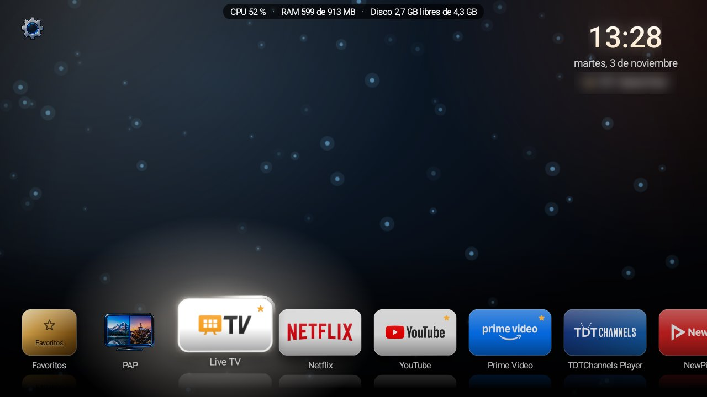
</p>

<p align="center">
  <a href="#qué-hace">Qué hace</a> ·
  <a href="#todas-las-opciones">Todas las opciones</a> ·
  <a href="#el-mando">El mando</a> ·
  <a href="#instalar">Instalar</a> ·
  <a href="#seguridad">Seguridad</a> ·
  <a href="#autor-y-licencia">Licencia</a>
</p>

## Qué hace

| | |
|---|---|
| **Inicio y dock** | Tus apps en un dock de 6 posiciones y 4 tamaños, con favoritos, fichas de cristal y una luz del color de la app que la sigue. |
| **MiniTV** | La antena, un HDMI o el AV en directo dentro del inicio, con su número de canal. OK la abre a pantalla completa. |
| **PAP y PIP** | Dos cosas a la vez: la antena y una app, o dos apps, una al lado de otra o una dentro de otra. También YouTube (web). |
| **Fondos** | Imágenes, GIF, vídeos y fondos animados HTML5 (Humo, Partículas, Halloween…), o los tuyos enviados desde el móvil. |
| **Encendido** | Apagar la TV en un rato, volumen máximo de noche y qué abrir al encender. |
| **Apps que sobran** | Las apps de anuncios, de fábrica e informes de *esa* TV, explicadas en español, para desactivarlas con un interruptor. |
| **Monitor y Liberar** | CPU, memoria y disco encima de todo, y un botón para limpiar la caché y cerrar lo que sobra. |

**Probado en:** Thomson 2K Android TV (`Thomson_2K_ATV2`, MediaTek) · Android TV 14 · 1 GB de RAM · mando Bluetooth Thomson.
Requiere Android 11 o superior. En otros modelos debería funcionar lo básico; la MiniTV y el PAP dependen de cómo el
fabricante exponga el sintonizador y las ventanas.

## Todas las opciones

Ajustes se abre con la tuerca de arriba a la izquierda del inicio: *Generales* son los ajustes de la TV y *Launcher* los de Stark TV, por pestañas. Todo va con el mando: ◀ ▶ cambian de pestaña y de valor,
▲ ▼ recorren las opciones y OK entra.

### Fondo

| Opción | Qué hace | Valores |
|---|---|---|
| Fondo | El fondo del inicio. | Castillo, Santa's Day, Humo, Partículas, Halloween y los tuyos (imagen, GIF, vídeo, HTML5) |
| Brillo | Oscurece el fondo para que se lea mejor lo de encima. | 0-100 %, de 10 en 10 |
| Cambiar fondo solo | Pasa al siguiente fondo cada cierto tiempo. | No, 15, 30 o 60 min |
| Ver la versión sobre el fondo | «Stark TV 0.9.x» abajo a la derecha. | Sí / No |
| Recibir fondos desde el móvil o PC | La TV enseña una dirección y una clave: desde el navegador se envían, ponen, renombran y borran fondos. | — |

<details><summary>Ver la pestaña Fondo</summary>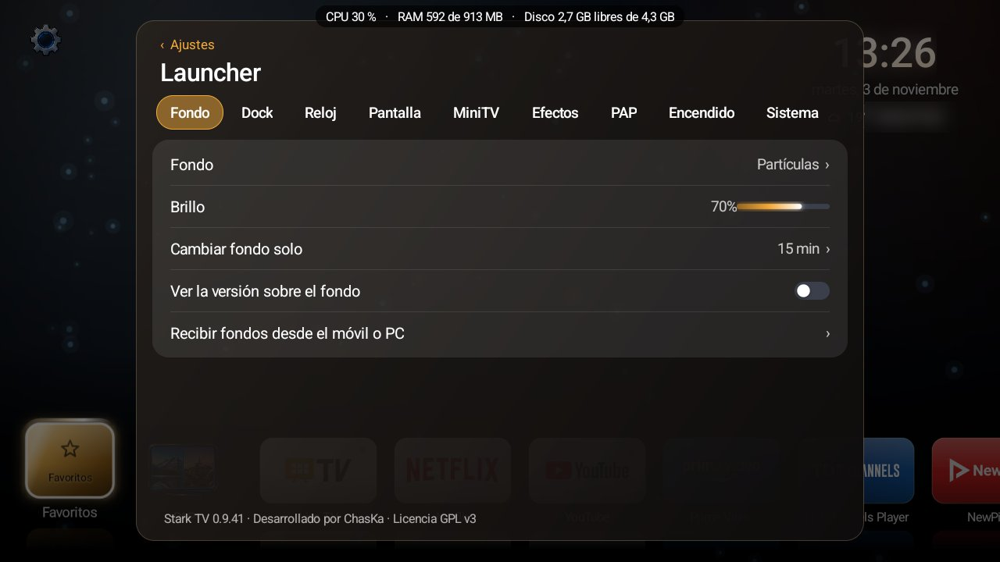</details>

### Dock

| Opción | Qué hace | Valores |
|---|---|---|
| Posición | Dónde va el dock. | Abajo, Centro, Arriba, Izquierda, Centro vertical, Derecha |
| Tamaño de fichas | Tamaño de cada app. | Micro, Pequeño, Mediano, Grande |
| Título del dock | El nombre de la app enfocada, encima del dock. | Sí / No |
| Favoritos en el dock | La ficha de Favoritos (hasta 6 apps) al principio. | Sí / No |
| Ocultar el dock (con la casa) | Solo queda una casa; al pulsarla salen las demás apps. | Sí / No |
| Nombre bajo las apps | El nombre debajo de cada ficha. | Sí / No |
| Apps ocultas | Las apps que no salen en el dock (ni en el PAP). | Lista |

<details><summary>Ver la pestaña Dock</summary>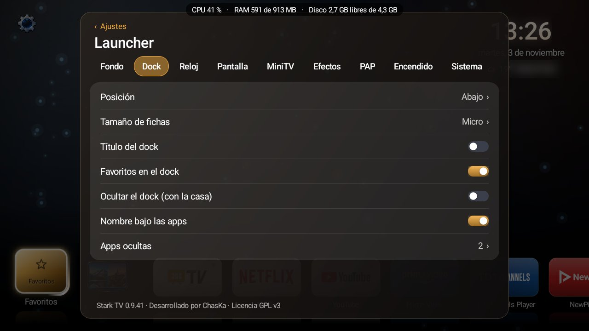</details>

### Reloj

| Opción | Qué hace | Valores |
|---|---|---|
| Reloj | Hora y fecha en el inicio. | Sí / No |
| Tiempo | Temperatura y cielo de tu ciudad (Open-Meteo, sin cuentas). | Sí / No |
| Ciudad | La ciudad del tiempo; se busca por nombre. | — |
| Posición | Dónde va el reloj. | Automática (el lado libre), Izquierda, Derecha |

<details><summary>Ver la pestaña Reloj</summary>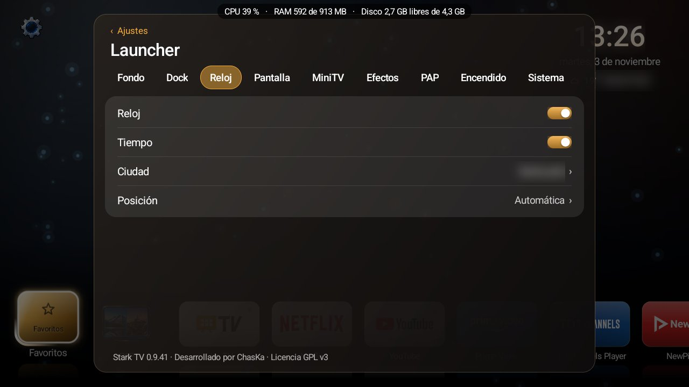</details>

### Pantalla

| Opción | Qué hace | Valores |
|---|---|---|
| Tipografía | La letra de todo Stark TV. | Sistema y 10 de Google Fonts (Manrope, Outfit, Sora, Poppins…) |
| Color de la interfaz | Tiñe paneles, interruptores, reloj, luz y selección. | Ámbar, Blanco, Azul, Verde, Rojo, Marrón, Violeta |
| Opacidad de los menús | Cuánto se transparentan los paneles. | 30-100 % |
| Oscuridad de los menús | Cuánto se oscurecen los colores de los paneles. | 0-90 % |
| Salvapantallas | Reloj grande, fecha y tiempo que cambian de sitio cada 5 s. Cualquier tecla lo quita. | No, 1, 5, 10 o 30 min |

<details><summary>Ver la pestaña Pantalla</summary>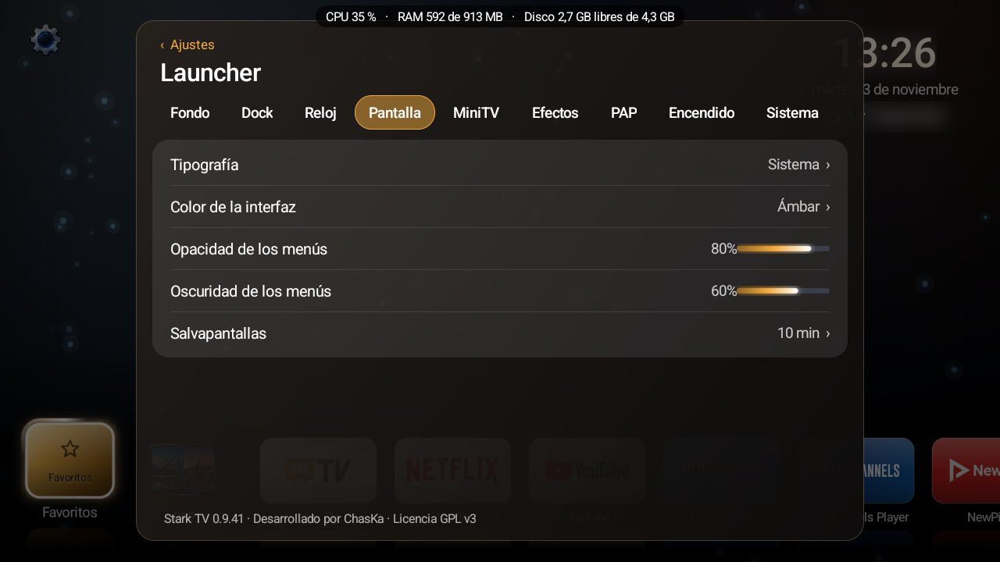</details>

### MiniTV

| Opción | Qué hace | Valores |
|---|---|---|
| Ventana de TV en directo | La TV dentro del inicio. Se aparta sola del dock y del reloj. | Sí / No |
| Fuente de la ventana | Qué se ve. Los HDMI salen con el nombre del aparato si lo da («PlayStation 5 (HDMI 2)»). | Antena, HDMI 1-3, AV |
| Tamaño de la ventana | En 2x va centrada en el hueco libre y el dock pasa a fichas micro. | 0,5x, 1x, 2x |
| Sonido de la ventana | Que suene la MiniTV. | Sí / No |
| Nombre del canal y la fuente | El número de canal sobre la imagen. | Sí / No |
| Canales de la antena | Si la TV no deja leer su lista, Stark TV la busca. En TVs MediaTek salen con el número y el orden de su app de TV. Radios opcionales. | Buscar |

En la MiniTV: **CH+ / CH−** cambian de canal, **OK** abre la app de TV de la tele en el mismo canal y **OK mantenido** abre su menú (fuente, posición, sonido).

<details><summary>Ver la pestaña MiniTV</summary>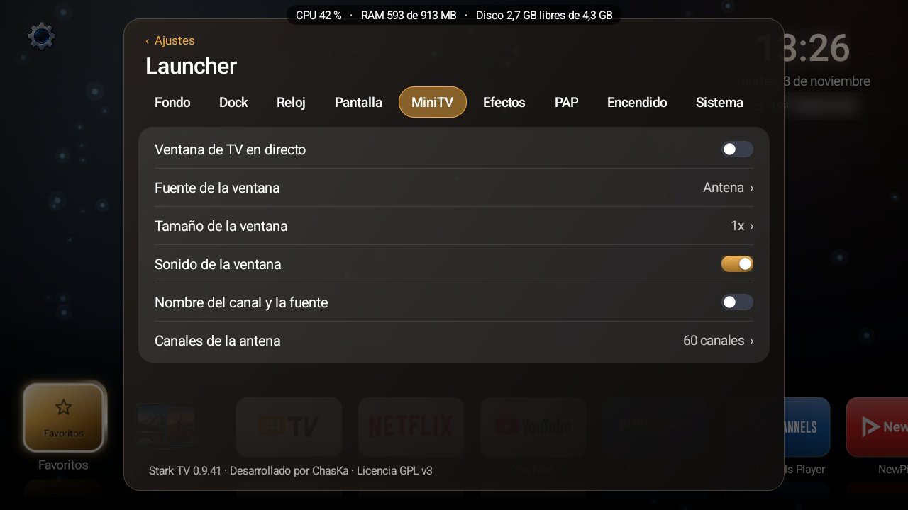</details>

### Efectos

| Opción | Qué hace | Valores |
|---|---|---|
| Reflejo en el suelo | El reflejo de las fichas bajo el dock. | Sí / No |
| Cristal difuminado | Los paneles con efecto de cristal. | Sí / No |
| Animaciones de luz | La luz que recorre el borde de la ficha enfocada. | Sí / No |

Si la TV va justa, apagar estos tres es lo que más se nota.

<details><summary>Ver la pestaña Efectos</summary>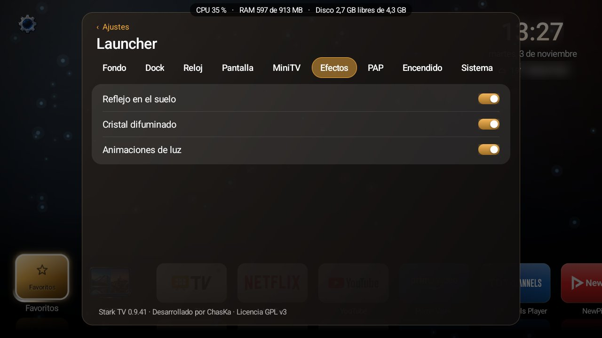</details>

### PAP

| Opción | Qué hace | Valores |
|---|---|---|
| Reparto | Cómo se parte la pantalla. | Mitad y mitad, Grande y pequeña, Pequeña y grande, Arriba y abajo, PIP en las 4 esquinas |
| Izquierda / Derecha (o Arriba / Abajo, Grande / Pequeña) | Qué va en cada parte. | Antena, HDMI 1-3, AV, YouTube (web) y tus apps (no las ocultas) |
| Sonido | Qué parte suena. | Una, la otra, las dos o ninguna |
| Aviso al empezar | Un recordatorio de cómo se maneja. | Desactivado, 3 o 5 s |
| Widget PAP en el inicio | Un botón de PAP en el inicio. | Sí / No |
| PAP en el dock | Una ficha de PAP en el dock. | Sí / No |
| Empezar PAP | Lo abre ya. | — |

<p align="center">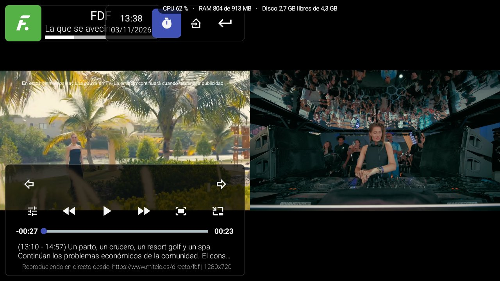</p>

Dentro del PAP, la **tuerca o la estrella** abren el selector (cambiar de parte, fuente, sonido y reparto, o intercambiar los lados) y **Inicio** sale del PAP y cierra sus apps.
Límites del chip (probado en la Thomson): la antena y una app de vídeo van a la vez; la app de YouTube y dos apps de vídeo, no (solo hay un decodificador). Para TV y YouTube, «YouTube (web)».

<details><summary>Ver la pestaña PAP</summary>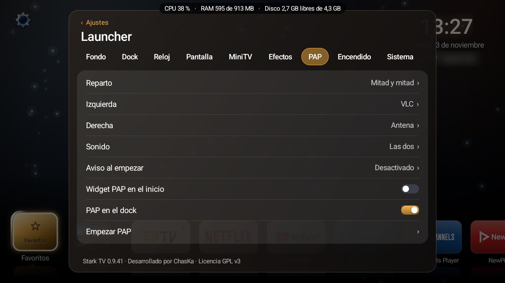</details>

### Encendido

| Opción | Qué hace | Valores |
|---|---|---|
| Apagar la TV en | Pone la TV en reposo pasado ese tiempo. Un minuto antes avisa; con OK se sigue viendo. | No, 15 min, 30 min, 1 h, 1 h 30, 2 h |
| Volumen máximo de noche | Si de noche se sube más, Stark TV lo baja solo. | Sin límite, 10-50 % |
| Horas de noche | Cuándo cuenta como noche. | 22:00 a 08:00, 20:00 a 07:00, Todo el día |
| Al encender la TV, abrir | Lo primero que sale al encender. | El inicio de Stark TV, La TV (antena) o cualquier app |

<details><summary>Ver la pestaña Encendido</summary>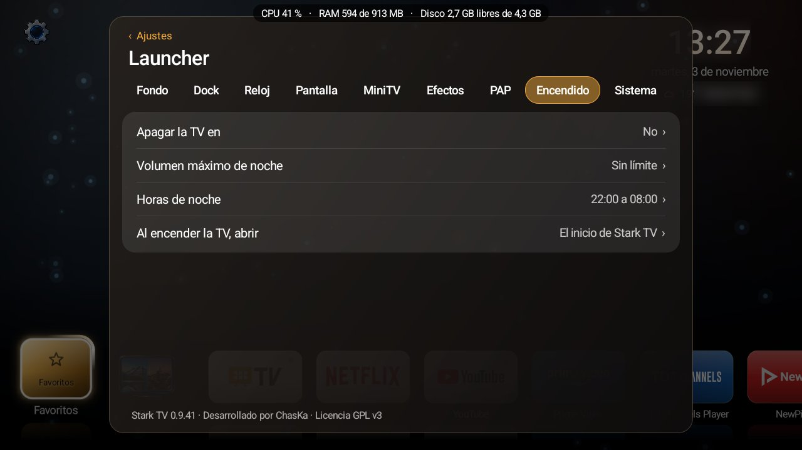</details>

### Sistema

| Opción | Qué hace | Valores |
|---|---|---|
| Permisos avanzados (adb) | Conecta Stark TV con la depuración de la propia TV (la TV pide aceptarlo una vez). Lo necesitan las opciones marcadas con ⚙. | — |
| Launcher por defecto | Stark TV como inicio de la TV (si se apaga, vuelve el de Google). | Sí / No |
| Apps que sobran ⚙ | Las apps de esa TV que se pueden desactivar, explicadas en español. Encendido = funcionando. Se vuelven a desactivar solas al encender y cuando Play las actualiza. | Lista e interruptores |
| Monitor de recursos | Una línea arriba, encima de cualquier app, con CPU, memoria y disco, cada 3 s (la CPU, con ⚙). | Sí / No |
| Dormir Play Store hasta que la abras ⚙ | Para Play Store (~70 MB) al encender y a los minutos de volver al inicio. | No, 1, 5 o 10 min |
| Liberar caché y memoria ⚙ | Borra la caché de todas las apps y cierra las de segundo plano, y dice cuánto ha liberado. Para cuando la TV va lenta. | — |
| Copia de ajustes | Guarda o recupera todos los ajustes de Stark TV. | — |

<details><summary>Ver la pestaña Sistema</summary>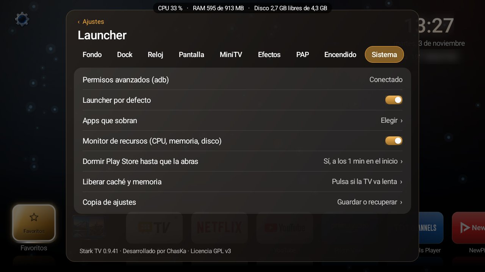</details>

<details><summary>Ver «Apps que sobran»</summary>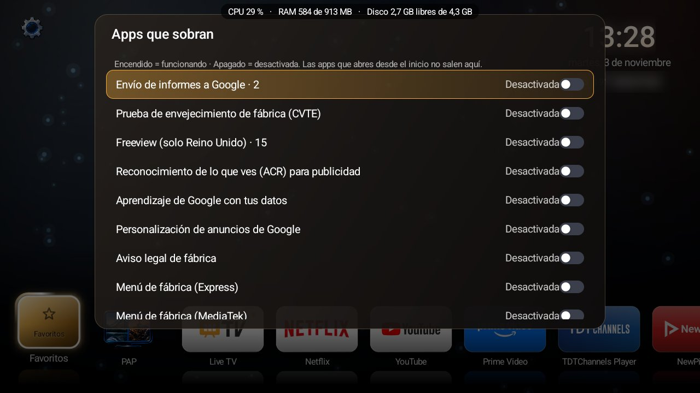</details>

## El mando

| Tecla | En el inicio | En el PAP |
|---|---|---|
| ◀ ▶ ▲ ▼ y OK | Moverse y abrir | Manejar la parte activa |
| **OK mantenido** sobre una app | Favoritos, mover, ocultar e información | — |
| **OK mantenido** sobre la casa o Favoritos | Elegir dónde va el dock | — |
| **Estrella** | Los favoritos de Stark TV | Abre el selector |
| **Tuerca** | — | Abre el selector; mantenida, cierra el PAP |
| **Inicio** | — | Sale del PAP y cierra sus apps |
| CH+ / CH− | Canal de la MiniTV | Canal de la antena |
| Jog | Una ficha por giro | — |

## Fondos

- Incluidos: **Castillo** y **Santa's Day** (imágenes), **Humo** y **Partículas** (HTML5) y **Halloween** (HTML5: murciélagos, niebla, cascadas, calabazas que se encienden y, cada 2-6 minutos, la Parca).
- Propios: **imagen** (jpg, png, webp), **GIF**, **vídeo** (mp4, mkv, webm, mov; en bucle y sin sonido) y **HTML5** (`.html` o `.zip` con su `index.html`).
- Se envían desde el móvil o el PC con *Fondo › Recibir fondos* (clave de 6 cifras nueva cada vez; las imágenes se guardan en WebP), o se dejan en `/sdcard/Fondos/`, `/sdcard/Download/` o `Fondos/` en un USB:
  ```bash
  adb push mi_fondo.mp4 /sdcard/Fondos/
  ```
- No gasta mientras ves otra app: el fondo se destruye al salir del inicio, y tras 3 minutos sin tocar el mando se queda quieto. Los HTML5 de la app van a 30 fps.

## Instalar

Descarga el APK de la [última versión](../../releases/latest) y, con la TV en la misma red y la depuración activada:

```bash
adb install -r StarkTV-0.9.41.apk
adb shell appops set com.chaska.inicio MANAGE_EXTERNAL_STORAGE allow
adb shell pm grant com.chaska.inicio android.permission.WRITE_SECURE_SETTINGS
adb shell cmd package set-home-activity com.chaska.inicio/.MainActivity
```

Luego pulsa Inicio en el mando y, en *Ajustes › Sistema › Permisos avanzados (adb)*, acepta la conexión en la TV (para el PAP, Apps que sobran y Liberar).

<details><summary>Si sigue saliendo el inicio de Google, o para volver a él</summary>

```bash
adb shell pm disable-user --user 0 com.google.android.tvlauncher
```

Volver al de Google:

```bash
adb shell pm enable com.google.android.tvlauncher
adb shell cmd package set-home-activity com.google.android.tvlauncher/.MainActivity
```
</details>

<details><summary>Compilar</summary>

Android Studio con el SDK 35, o `gradlew.bat assembleRelease`.
El APK de release sale como `StarkTV-<versión>.apk` y se firma con *Build › Generate Signed APK* y una clave propia.
La clave **nunca** va al repositorio: `.gitignore` deja fuera `Key`, `*.jks`, `*.keystore`, `app/release/` y los `.apk`.
</details>

## Seguridad

Que la TV no corra riesgo por usar el launcher.

<details><summary>Qué se comprueba</summary>

- **Archivos recibidos**:
  - Solo se admiten las extensiones de la lista, con el nombre saneado, sin rutas.
  - Cada archivo se comprueba por su contenido, no solo por la extensión. Un archivo disfrazado se rechaza.
  - Se les **quitan los metadatos**: EXIF (también el GPS), XMP, perfiles, comentarios, etiquetas de vídeo y adjuntos (en las imágenes sin volver a comprimir; en los vídeos sin mover nada).
  - Si algo no se puede comprobar o limpiar, no se guarda.
  - Imágenes de más de 8192 px de lado, HTML de más de 5 MB y archivos de más de 1 GB se rechazan.
- **.zip de HTML5**: solo se sacan los tipos permitidos (HTML, imágenes, vídeo, CSS, JS, fuentes); como mucho 500 archivos y 300 MB; ningún archivo puede salir de su carpeta.
- **HTML recibidos**, encerrados: sin red, sin poder leer archivos de la TV, solo cargan lo de su carpeta y no navegan a otras páginas.
- **HTML de USB, Descargas o `/sdcard`**: no se abren. De ahí solo se usan imágenes y vídeos.
- **Recepción**:
  - Solo mientras su pantalla está abierta y solo desde la red de casa.
  - Clave de 6 cifras aleatoria segura, nueva cada vez; la página da al navegador una sesión propia (cookie aleatoria de 128 bits, `HttpOnly`, `SameSite=Strict`) que muere al cerrar la pantalla.
  - Las órdenes solo se aceptan desde la propia página (cabecera propia), no desde otras webs.
  - Freno de intentos: con 5 fallos, ese aparato se queda fuera; con 20 en total, se cierra la recepción.
  - Como mucho 4 conexiones y una subida a la vez, con cabeceras de seguridad.
- **Órdenes al sistema (adb)**: solo con caracteres permitidos (o una orden fija de la lista), los nombres de app se validan y la copia de ajustes se acota al restaurarla.
- **YouTube (web)**: solo abre YouTube y el inicio de sesión de Google; solo se concede el vídeo protegido (ni cámara ni micrófono).
- **Registro**: no se registra lo que se pulsa en el mando, salvo que se active a propósito para depurar.
- **Copias de Android**: la app no se incluye en las copias (`allowBackup=false`). La versión publicada se firma con una clave propia que no está en este repositorio.
</details>

## Autor y licencia

Desarrollado por **ChasKa**.

Stark TV es software libre: puedes redistribuirlo y modificarlo según los términos de la
**Licencia Pública General de GNU, versión 3** (GPL-3.0), publicada por la Free Software Foundation.
Se distribuye SIN NINGUNA GARANTÍA. El texto completo está en [`LICENSE`](LICENSE).

<details><summary>Componentes de terceros</summary>

| Componente | Uso | Licencia |
|---|---|---|
| [dadb](https://github.com/mobile-dev-inc/dadb) (mobile.dev) | Hablar con la depuración de la propia TV (PAP, sonido por app) | Apache License 2.0 |
| Tipografías de [Google Fonts](https://fonts.google.com): DM Sans, Lexend, Manrope, Montserrat, Outfit, Plus Jakarta Sans, Poppins, Sora, Space Grotesk y Urbanist | Tipografías de la interfaz | SIL Open Font License 1.1 (textos en `app/src/main/assets/fuentes/licencias`) |
| [Open-Meteo](https://open-meteo.com) | Datos del tiempo y búsqueda de la ciudad (sin clave, por HTTPS) | Datos bajo CC BY 4.0 — *Weather data by Open-Meteo.com* |
| Android SDK de Google | Base de la app | Apache License 2.0 |
| Ideas de [CleanYourTV](https://github.com/Gathin23/cleanyourtv) (Gathin y colaboradores): listas por modelo y los módulos Sources, Sleep Timer, Quiet Hours y Open on wake | Apps que sobran, nombres de las fuentes, pestaña Encendido | MIT |

Las imágenes de los fondos *Castillo*, *Halloween* y *Santa's Day* y los iconos de la interfaz son aportados por ChasKa para este proyecto.
Android y Android TV son marcas de Google LLC; Thomson es marca de su titular. Este proyecto no está afiliado a ninguna de ellas.

**Listas de «Apps que sobran»**: la lista de `app/src/main/assets/sobran.json` junta las medidas por Stark TV en TVs reales, las marcadas como «recomendadas» por [Universal Android Debloater Next Generation](https://github.com/Universal-Debloater-Alliance/universal-android-debloater-next-generation) (GPL-3.0), las de [Projectivy Launcher](https://github.com/spocky/miproja1) que faltaban y las de las 428 TVs probadas de [CleanYourTV](https://github.com/Gathin23/cleanyourtv) (MIT, © 2026 Gathin), con la explicación traducida; las que tocan la antena, el teclado, la red, el inicio o piezas básicas de Android se dejaron fuera. Stark TV solo enseña las que hay en cada TV, nunca las apps que se abren desde el inicio, y todo se puede volver a activar.
</details>
